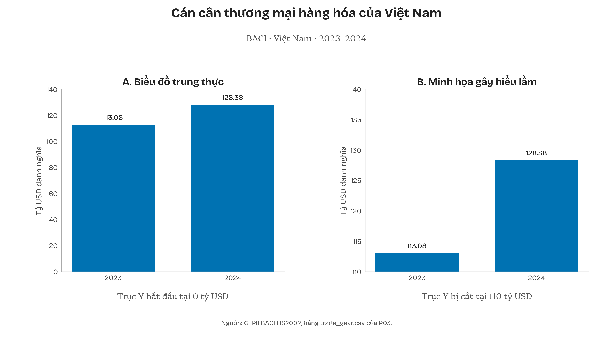

# Phụ lục T12 Biểu đồ trung thực và biểu đồ gây hiểu lầm

Cán cân thương mại hàng hóa của Việt Nam theo BACI tăng từ **113.08 tỷ USD năm 2023** lên **128.38 tỷ USD năm 2024**, tương đương **15.30 tỷ USD** hay **13.53%** so với năm 2023. Hai biểu đồ dưới đây dùng cùng hai quan sát, đơn vị, màu và nhãn số. Điểm thay đổi là miền hiển thị trên trục Y. [BACI HS2002 · Bảng thương mại theo năm](../../data/baci/data_clean/trade_year.csv)



**Hình T12.1. Cán cân thương mại hàng hóa của Việt Nam giai đoạn 2023–2024, tỷ USD danh nghĩa.** Ô A biểu diễn mức cán cân bằng chiều cao tính từ 0. Ô B là ví dụ cố ý gây hiểu lầm bằng cách cắt trục tại 110 tỷ USD.

## Thủ thuật và tác động

Trong ô A, thanh năm 2024 cao khoảng **1.14 lần** thanh năm 2023 vì cả hai được đo từ 0. Trong ô B, phần nhìn thấy của hai thanh chỉ còn khoảng **3.08** và **18.38 tỷ USD** tính từ mép dưới hình. Tỷ số chiều cao nhìn thấy vì vậy tăng lên khoảng **5.97 lần**, mặc dù tỷ lệ giữa hai giá trị nguồn vẫn khoảng 1.14.

Thủ thuật khai thác cách người xem so chiều dài thanh trên cùng một mốc. Hình B có thể khiến người xem đánh giá mức tăng lớn hơn thực tế trước khi đọc nhãn số. Nguyên tắc dùng vị trí trên thang chung và chiều dài để so sánh độ lớn được trình bày trong Lecture 3, slide 23–28 và Tutorial 3, chương 5. [Lecture 3](../../../Lecture-3.pdf) · [Tutorial 3](../../../Tutorials-3.pdf)

## Cách phát hiện khi đọc biểu đồ

1. **Đọc mốc thấp nhất của trục.** Trong ô B, mép dưới là 110 tỷ USD. Với biểu đồ cột dùng để so độ lớn, mốc 0 giữ quan hệ tỷ lệ giữa chiều cao và giá trị.
2. **Đối chiếu nhãn với hình dạng.** Hai nhãn là 113.08 và 128.38 tỷ USD. Tính mức tăng từ số gốc theo công thức `(cán cân 2024 − cán cân 2023) / cán cân 2023 × 100` cho kết quả 13.53%.
3. **Kiểm tra giai đoạn và đơn vị.** Cả hai ô chỉ so sánh năm 2023 và 2024, cùng tính theo tỷ USD danh nghĩa. Nếu mục tiêu là đọc xu hướng dài hạn, xem thêm các năm trong bảng nguồn.

## Tái tạo hình

Chạy từ thư mục gốc của repo trong môi trường Python có Matplotlib và House Style.

```powershell
python -m docs.appendix.t12_honest_vs_misleading
```

Script lấy `trade_balance_usd` của Việt Nam trong hai năm 2023 và 2024, đổi từ USD sang tỷ USD và dùng cùng giá trị cho cả hai ô. [Script tạo hình](t12_honest_vs_misleading.py)
