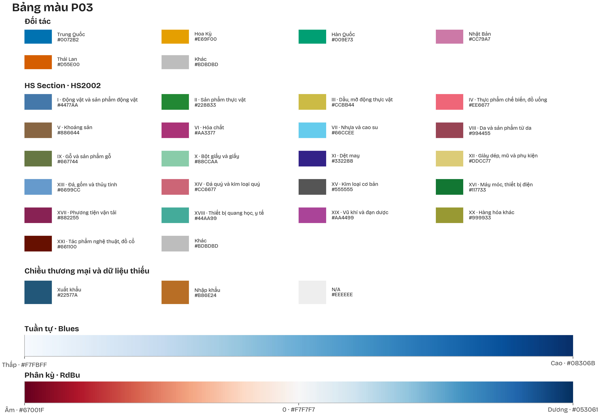
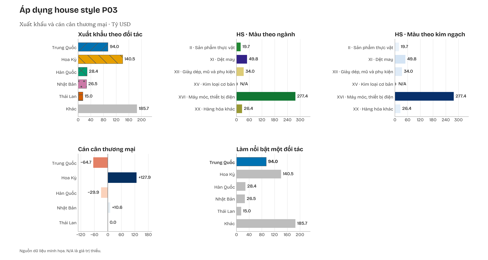
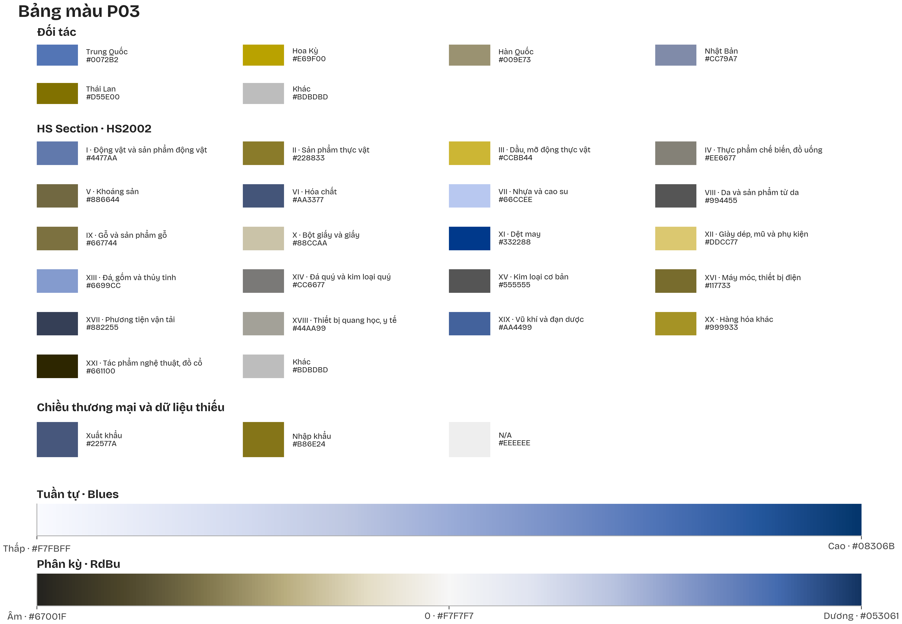
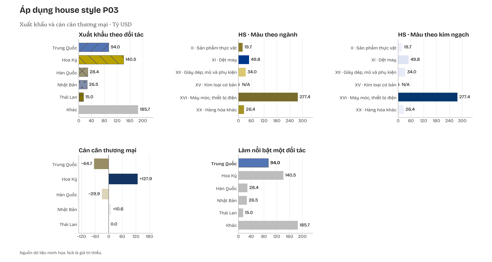
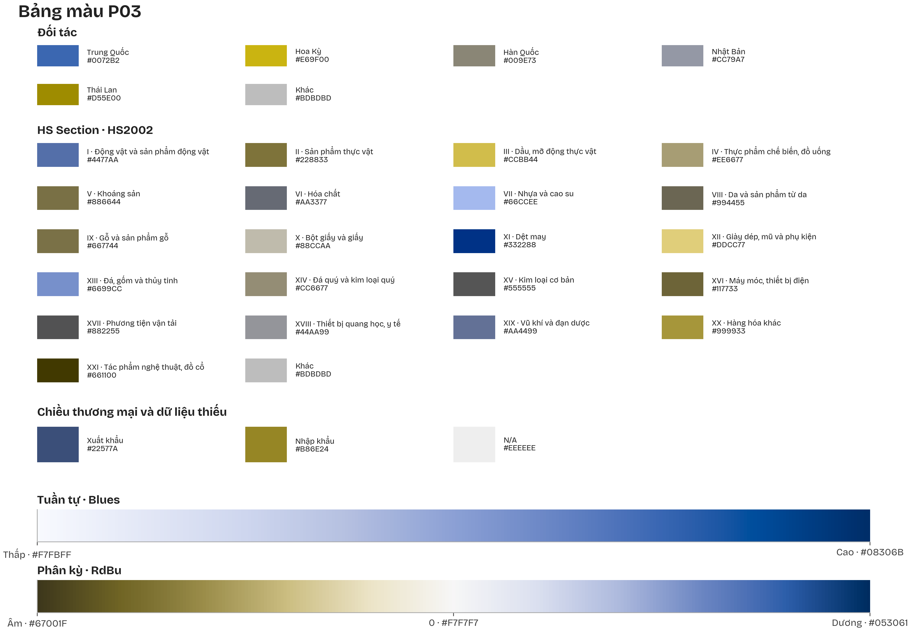
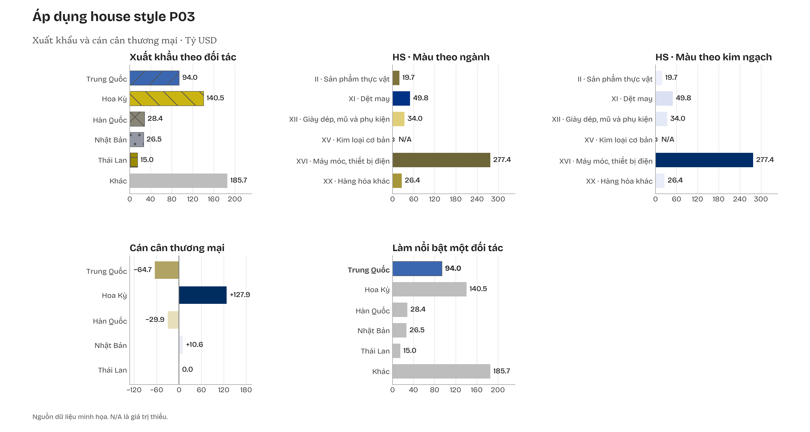
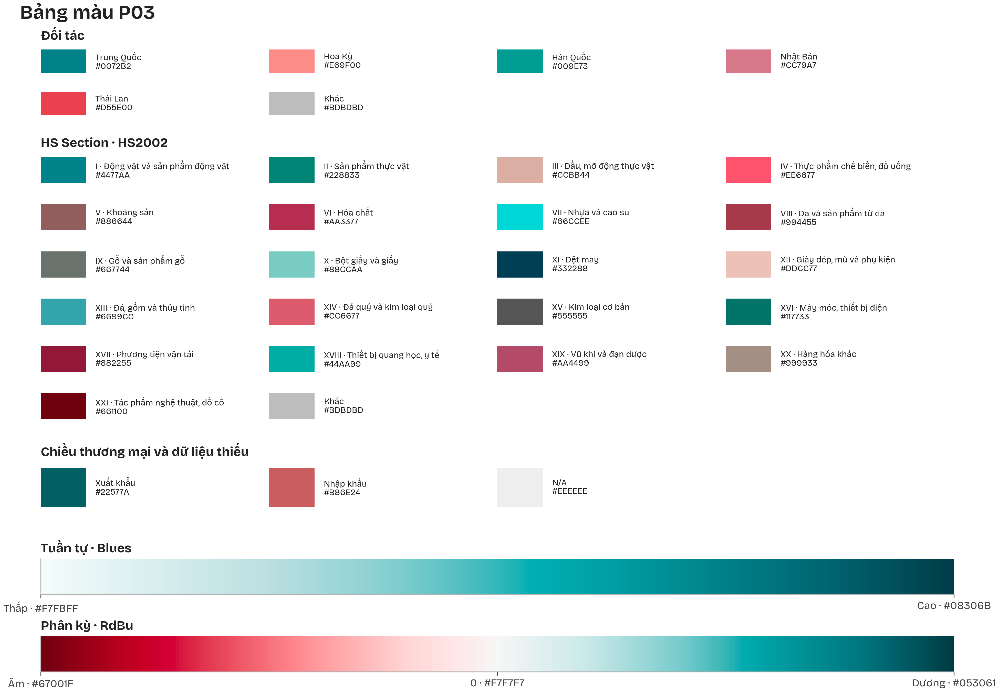
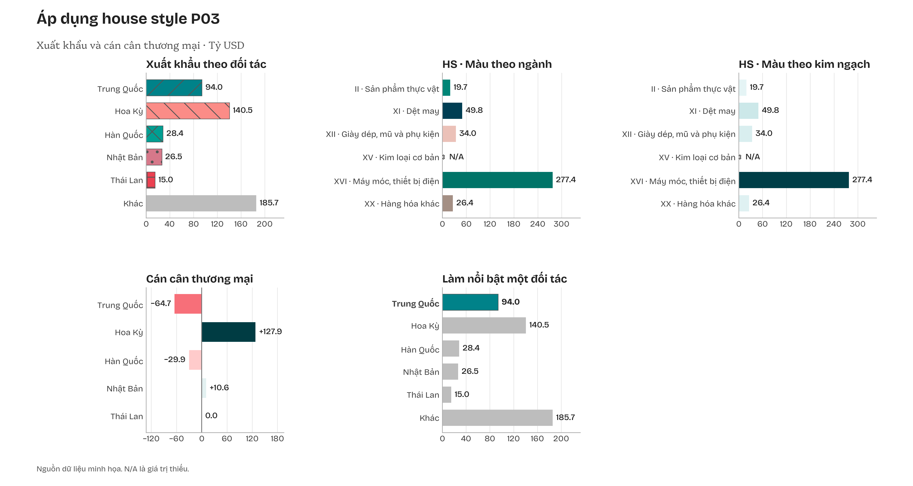
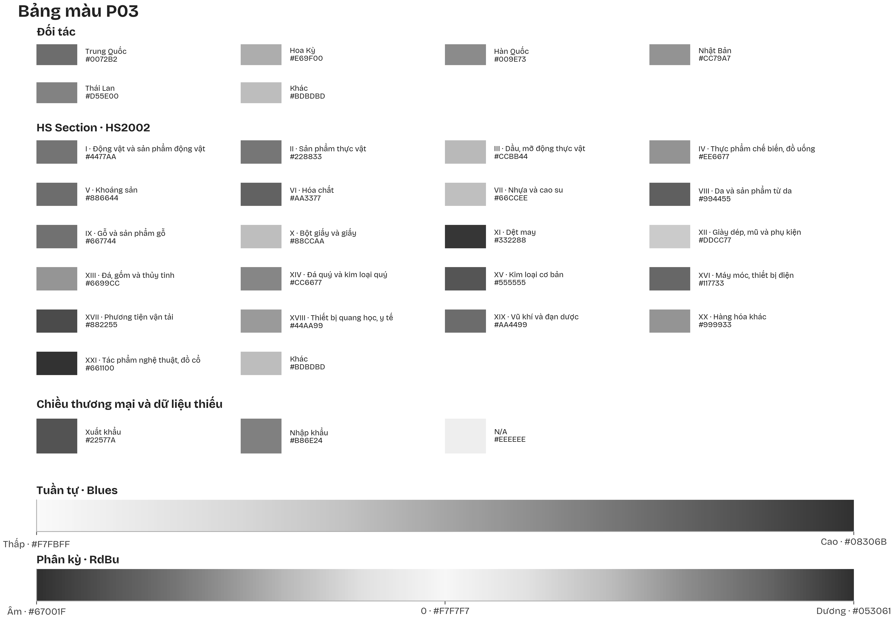
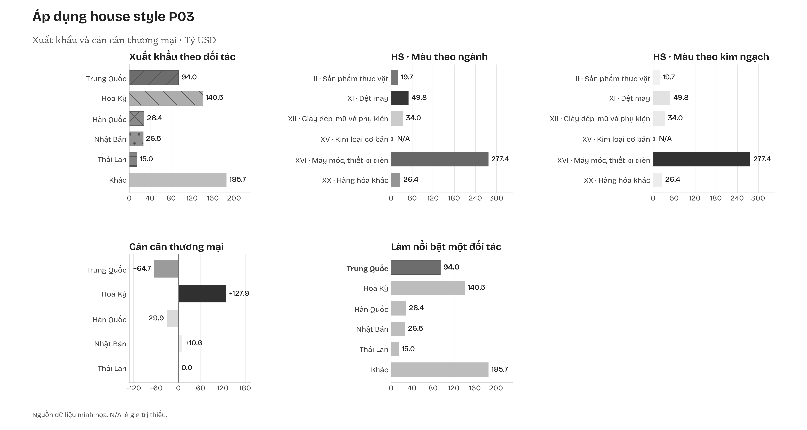

# House Style P03 · Đặc tả thiết kế và báo cáo kiểm chứng

**Phạm vi:** phiên bản House Style hiện có trong repository, gồm Typography Modern Editorial và bộ ảnh minh chứng. **Kết quả rà soát:** 13/13 kiểm thử tự động đạt trong lần chạy phục vụ báo cáo. Các hình dùng số liệu minh họa để kiểm chứng cách trình bày. Mọi đề xuất trong báo cáo được ghi riêng với quy chuẩn đã triển khai.

## 1. Tổng quan

House Style thống nhất cách trình bày biểu đồ P03 về màu, thứ tự nhóm, font, số và đơn vị. Mục đích là giúp người đọc nhận ra cùng một đối tác qua nhiều hình, hiểu ngay màu đang chỉ **nhóm nào**, **giá trị lớn đến đâu** hay **nằm phía nào của mốc 0**, và vẫn đọc được biểu đồ khi mất thông tin màu.

Package `house_style/` tách quy chuẩn khỏi phần vẽ biểu đồ. Một notebook có thể dùng theme và formatter chung rồi chọn bảng màu theo câu hỏi. Cấu hình hiện phù hợp để tái sử dụng cho BACI, WDI, mạng thương mại và khảo sát, với mức tích hợp khác nhau được ghi ở mục 8. Bằng chứng hiện tập trung vào biểu đồ đối tác, HS Section, cán cân và điểm nhấn.

Phong cách **Modern Editorial** kết hợp chữ sans-serif cho dữ liệu với chữ serif cho phần diễn giải, nền trắng và lưới nhẹ. Tính nhất quán được duy trì nhờ ánh xạ theo mã, tiêu chuẩn đơn vị và cấu hình Matplotlib dùng chung. Các nhận định về sự hài hòa, khả năng đọc và cấp bậc thị giác dưới đây là phân tích từ mã và ảnh mẫu. Giá trị HEX và thông số được đối chiếu trực tiếp với source.

## 2. Cơ sở lý thuyết

| Nguyên tắc | Bài giảng | Cách áp dụng và bằng chứng | Thành phần |
|---|---|---|---|
| **Data Abstraction** | Lecture 2, slide 8–12, 15–20 | Phân biệt bảng, mạng, cây, khóa và thuộc tính. Mã ISO3 hay HS nhận diện nhóm. Kim ngạch là lượng đo. Cán cân có hai phía quanh 0. T09 ghi kiểu và đơn vị từng trường. | T09, bảng màu, thang màu, formatter |
| **Visual Encoding** | Lecture 3, slide 23–28 | Thanh ngang dùng vị trí và chiều dài để so lượng. Màu bổ sung danh tính hoặc độ lớn. Hình 2 đặt hai cách tô HS cạnh nhau để minh họa sự khác biệt. | `evidence/generate.py`, `hs_palette.py`, `sequential.py` |
| **Visual Perception** | Lecture 3, slide 7–9 | Nhãn nằm gần thanh giúp giảm việc dò qua lại giữa hình và chú giải. Thứ tự nhất quán giúp người xem tìm nhóm nhanh hơn. | `ordered_present()`, nhãn trục, `bar_label()` |
| **Preattentive Attributes** | Lecture 3, slide 12–14, 37 | Một màu nhấn trên nền xám hướng sự chú ý đến nhóm được chọn. Mẫu còn dùng chữ đậm để duy trì điểm nhấn trên bản xám. | `highlight.py`, Hình 2 và 10 |
| **Gestalt** | Lecture 3, slide 15–19 | **Proximity:** nhãn số cạnh thanh. **Similarity:** một mã giữ màu qua các hình. Thanh trong cùng ô có vị trí và trục chung để dễ đối chiếu. | Bảng màu, `draw_bars()` |
| **Visual Hierarchy** | Lecture 3, slide 13, 38 | Tiêu đề đậm, phụ đề và nguồn có cấp chữ riêng. Hình kiểm thử dùng tiêu đề mô tả. Slide 38 minh họa tiêu đề nêu phát hiện cho hình báo cáo. | `typography.py`, Hình 2 |
| **Colour Theory** | Lecture 3, slide 39–42, 46, 48 | Màu phân loại cho danh tính, `Blues` cho độ lớn, `RdBu` cho chênh lệch quanh mốc có ý nghĩa. | Bảng màu và hai module thang màu |
| **Decluttering** | Lecture 3, slide 32–36, Tutorial 3 chương 3 | Ẩn viền trên và phải, tinh giản trục, dùng nhãn trực tiếp. Ví dụ bài giảng bỏ lưới ở một bước. P03 giữ lưới định lượng nhẹ để hỗ trợ đọc thanh. | `theme.py`, Hình 2 |
| **Accessibility** | Lecture 3, slide 43–44, 47, 49, Tutorial 3 §6.5–6.6 | Đối chiếu màu gốc với thang xám và mô phỏng CVD. Tên, họa tiết, nét, dấu số và vị trí hỗ trợ khi màu khó phân biệt. | `accessibility.py`, Hình 3–10 |

Lecture 3, slide 56 yêu cầu bộ màu phân loại cố định, một thang tuần tự, một thang phân kỳ, font, định dạng số và bằng chứng khả năng đọc. **Bricolage Grotesque, Platypi, các mã HEX, bố cục, số nhóm đối tác và PNG 300 DPI** là các lựa chọn của P03. Tutorial chương 7 minh họa PNG 200 DPI và PDF tùy mục đích. Yêu cầu vẽ lại một biểu đồ đã công bố thuộc phần bàn giao M3 rộng hơn. [Lecture 2][lec2] · [Lecture 3][lec3] · [Tutorial 3][tut3]

## 3. Nhận diện thị giác

**Xanh `#0072B2` là màu nhấn dự phòng**. Trong bảng phân loại đối tác, màu này nhận diện CHN. Bảng chiều thương mại có hệ xanh–cam riêng. House Style hiện dùng vai trò và ngữ cảnh để phân biệt các hệ màu, còn sắc trắng và xám tạo diện mạo chung qua các hình.

| Tên màu | HEX | Mẫu | Vai trò | Lý do sử dụng | Vị trí |
|---|---|---|---|---|---|
| Xanh nhấn | `#0072B2` | <span style="color:#0072B2;background-color:#0072B2">■</span> | Màu nhấn dự phòng, đồng thời là màu CHN trong palette đối tác | Một mảng xanh trên nền xám tạo điểm nhìn. Ở biểu đồ phân loại, cùng mã màu có nghĩa theo bảng màu đang dùng. | `highlight.py, partner_palette.py` |
| Xanh và cam chiều thương mại | `#22577A` | <span style="color:#22577A;background-color:#22577A">■</span> | Màu xuất khẩu | Tạo một cặp phân loại với màu nhập khẩu. Nét và marker bổ sung ý nghĩa. | `trade_flow.py` |
| Cam chiều thương mại | `#B86E24` | <span style="color:#B86E24;background-color:#B86E24">■</span> | Màu nhập khẩu | Tách hai chiều thương mại trong hình so sánh trực tiếp. | `trade_flow.py` |
| Trắng | `#FFFFFF` | <span style="color:#FFFFFF;background-color:#FFFFFF">■</span> | Nền figure, vùng vẽ và ảnh xuất | Giữ độ tương phản với chữ tối và khoảng trắng giữa các ô. | `theme.py` |
| Chữ chính | `#222222` | <span style="color:#222222;background-color:#222222">■</span> | Màu chữ mặc định | Phân cấp ưu tiên đọc tiêu đề và nhãn trên nền trắng. | `typography.py` |
| Chữ nhãn trục | `#333333` | <span style="color:#333333;background-color:#333333">■</span> | Tên biến và đơn vị | Giữ độ tương phản cao khi đọc trục. | `typography.py` |
| Chữ vạch chia | `#444444` | <span style="color:#444444;background-color:#444444">■</span> | Tick labels | Giữ mốc đo dễ đọc, giảm độ nổi so với tiêu đề. | `typography.py` |
| Chữ bổ trợ | `#555555` | <span style="color:#555555;background-color:#555555">■</span> | Phụ đề và nguồn | Phân biệt thông tin giải thích với tiêu đề và số liệu. | `typography.py` |
| Lưới | `#E5E5E5` | <span style="color:#E5E5E5;background-color:#E5E5E5">■</span> | Đường dẫn định lượng | Hỗ trợ dò mốc mà ít cạnh tranh với thanh dữ liệu. | `theme.py` |
| Viền | `#AAAAAA` | <span style="color:#AAAAAA;background-color:#AAAAAA">■</span> | Màu viền vùng vẽ | Giữ ranh giới trục còn lại ở mức nhẹ. | `theme.py` |
| Đường 0 | `#777777` | <span style="color:#777777;background-color:#777777">■</span> | Mốc tham chiếu của cán cân | Cho thấy ranh giới giữa âm và dương kể cả khi in xám. | `theme.py` |
| Other và Context | `#BDBDBD` | <span style="color:#BDBDBD;background-color:#BDBDBD">■</span> | Nhóm gộp và nhóm làm nền | Cùng sắc xám nhưng ý nghĩa do chế độ biểu đồ và nhãn xác định. | `colour_rules.py, highlight.py` |
| Missing | `#EEEEEE` | <span style="color:#EEEEEE;background-color:#EEEEEE">■</span> | Dữ liệu thiếu, kèm N/A | Giá trị thiếu được nhận diện bằng chữ hoặc ký hiệu, vì màu gần nền trắng. | `colour_rules.py` |

Các ô mẫu màu được hiển thị chính xác trong **Hình 1** khi trình đọc Markdown giới hạn HTML. Chữ chính, nhãn trục và chữ vạch chia trên nền trắng có tỷ lệ tương phản tính theo công thức trong bài kiểm thử lần lượt khoảng **15,91:1**, **12,63:1** và **9,74:1**. Chữ phụ `#555555` trên nền trắng có tỷ lệ khoảng **7,46:1** theo cùng phép tính. Các tỷ lệ này áp dụng cho cặp màu xác định, còn khả năng đọc ở khoảng cách trình chiếu phụ thuộc vào kích thước chữ thực tế.

Bảng màu đối tác dùng các sắc khác nhau để nhận diện, trong khi thang tuần tự chủ yếu thay đổi độ sáng. Để hình bớt cạnh tranh về màu, mẫu nhấn chuyển bối cảnh về xám, còn hình so sánh độ lớn có thể dùng một màu hoặc một thang tuần tự. Hai chế độ sau có vai trò khác nhau: một màu để vị trí và chiều dài làm việc chính, còn thang tuần tự dùng độ đậm để mã hóa thêm giá trị.

## 4. Hệ thống font chữ

### 4.1. Họ font và lý do phối hợp

| Họ font | Hình thái và vai trò | Lý do lựa chọn và bằng chứng |
|---|---|---|
| **Bricolage Grotesque** | Sans-serif. Dùng cho tiêu đề, trục, tick, chú giải, số liệu, KPI và nguồn. Ba bản tĩnh Regular 400, Medium 500 và Bold 700 được tạo từ font biến thiên với độ rộng 100 và cỡ quang học 14. | Tiêu đề đậm tạo trọng tâm, trong khi trục và số liệu giữ dạng chữ cùng họ ở mức nhẹ hơn. Dạng không chân giúp giảm chi tiết ở các hàng số nhỏ. Kiểm thử xác nhận Matplotlib chọn đúng ba tệp đi kèm và các glyph tiếng Việt, ký hiệu số liệu đã kiểm. [Nguồn Bricolage Grotesque][bricolage] |
| **Platypi** | Serif, bản upright. Dùng cho phụ đề và chú thích diễn giải khi truyền đúng style theo vai trò. | Chân chữ và dáng chữ khác biệt tạo tín hiệu rằng đoạn này cung cấp bối cảnh. Hình 2 minh họa phụ đề Platypi dưới tiêu đề Bricolage Grotesque. Bài test render minh họa thêm chú thích Platypi. [Nguồn Platypi][platypi] |
| **DejaVu Sans** | Sans-serif dự phòng, đứng thứ hai trong cả hai danh sách font. | Giữ một lựa chọn thay thế trong môi trường Matplotlib. Bộ test hiện xác nhận cấu hình thứ tự và kiểm tra trực tiếp glyph của hai họ font chính. |

Hai họ chính có giấy phép **SIL Open Font License 1.1** đi kèm trong `fonts/`. `register_fonts()` tìm tệp theo đường dẫn của module, đăng ký bằng `font_manager.fontManager.addfont()` và ghi nhớ lần đăng ký trong tiến trình Python. `apply_style()` dùng `rc_context()` để áp dụng cấu hình và phục hồi các giá trị `rcParams` khi thoát khối. [Giấy phép Bricolage Grotesque][oflb] · [Giấy phép Platypi][oflp] · [Matplotlib Font Manager][mplfont]

### 4.2. Phân cấp Typography

| Thành phần | Họ font | Weight | Cỡ | Màu | Căn lề | Vai trò |
|---|---|---|---|---|---|---|
| Tiêu đề figure | Bricolage Grotesque | Bold | 18 pt | `#222222` mặc định | Hình mẫu đặt trái | Điểm bắt đầu đọc hình |
| Tiêu đề ô | Bricolage Grotesque | Bold | 18 pt mặc định, mẫu biểu đồ 13 pt, mẫu bảng màu 12 pt | `#222222` mặc định | Trái theo rcParams | Nêu nội dung từng ô |
| Phụ đề | Platypi | Regular kế thừa | 12 pt | `#555555` | Trái | Nêu chỉ tiêu, phạm vi và đơn vị |
| Nhãn trục | Bricolage Grotesque | Medium | 11 pt | `#333333` | Theo vị trí trục | Xác định biến đo |
| Tick labels | Bricolage Grotesque | Regular mặc định, tên nhóm nhấn được in đậm trong mẫu | 10 pt | `#444444` | Theo trục | Tra nhóm và mốc |
| Chú giải | Bricolage Grotesque | Regular kế thừa | 10 pt | Kế thừa | Theo bố cục hình | Giải mã kênh thị giác khi cần |
| Nhãn giá trị | Bricolage Grotesque | Medium, Bold cho thanh được nhấn | 10 pt | `#222222` mặc định | Do `bar_label()` đặt cạnh thanh | Đọc số trực tiếp |
| Chú thích diễn giải | Platypi | Kế thừa | Kế thừa 10 pt nếu không ghi đè | Kế thừa | Do biểu đồ đặt | Giải thích một điểm hoặc phát hiện |
| KPI | Bricolage Grotesque | Bold | Kế thừa hoặc do biểu đồ đặt | Kế thừa | Do biểu đồ đặt | Nhấn số chủ chốt |
| Dòng nguồn và ghi chú mẫu | Bricolage Grotesque | Regular kế thừa | 9 pt | `#555555` | Trái | Nêu nguồn và giải thích N/A |

Các trị số kế thừa đến từ cấu hình Matplotlib trong khối style. `KPI` chỉ khai báo họ font và độ đậm, còn `ANNOTATION` chỉ khai báo họ font. Trong ảnh minh chứng, nhãn **N/A** được đặt bằng `annotate()` nhưng áp dụng `DIRECT_LABEL` vì nó là nhãn dữ liệu. Hình 2 có minh chứng cho tiêu đề, phụ đề, nhãn và nguồn. Mẫu Typography độc lập và ảnh KPI hiện chưa có. Kiểm thử bao phủ chữ tiếng Việt hoa/thường và nhóm ký hiệu gồm chữ số, `%`, `−`, `+`, `×`, `₫`, dấu phân cách và dấu gạch. Khả năng đọc ở cuối lớp chưa được đo trên thiết bị trình chiếu.

## 5. Hệ thống màu

### 5.1. Đối tác

README ghi tiêu chí tham chiếu là tổng xuất khẩu + nhập khẩu trong `partner_year.csv`, giai đoạn **2005–2024**. Module hiện lưu danh sách cố định và dùng **ISO3** để tra bảng, nên thay đổi năm hoặc chiều thương mại không tự xếp lại màu. Cột mã BACI trong bảng dưới dùng để đối chiếu T09.

| Thứ tự trong code | Mã BACI | ISO3 / khóa | Tên | HEX | Mẫu | Marker / nét / hatch |
|---|---|---|---|---|---|---|
| 1 | 156 | `CHN` | Trung Quốc | `#0072B2` | <span style="color:#0072B2;background-color:#0072B2">■</span> | o / liền / sọc chéo xuôi |
| 2 | 842 | `USA` | Hoa Kỳ | `#E69F00` | <span style="color:#E69F00;background-color:#E69F00">■</span> | s / đứt / sọc chéo ngược |
| 3 | 410 | `KOR` | Hàn Quốc | `#009E73` | <span style="color:#009E73;background-color:#009E73">■</span> | ^ / gạch-chấm / dấu chéo |
| 4 | 392 | `JPN` | Nhật Bản | `#CC79A7` | <span style="color:#CC79A7;background-color:#CC79A7">■</span> | D / chấm / chấm |
| 5 | 764 | `THA` | Thái Lan | `#D55E00` | <span style="color:#D55E00;background-color:#D55E00">■</span> | P / gạch dài (8, 3) / dấu cộng |
| 6 | — | `Other` | Khác | `#BDBDBD` | <span style="color:#BDBDBD;background-color:#BDBDBD">■</span> | x / gạch ngắn (2, 2) / màu đặc |

`partner_group()` chuẩn hóa khoảng trắng và chữ hoa. Mã ba chữ hợp lệ về hình thức ngoài bảng được gom vào `Other`. Một số mã tổng hợp như `WLD` và giá trị thiếu trả về `None`. Việc kiểm tra hiện dựa trên mẫu ba chữ và danh sách loại trừ, nên cần đối chiếu danh mục nguồn khi sử dụng mã BACI có chữ số.

**Đối chiếu T09:** Top 5 theo `network_nodes.csv` là `156/CHN`, `842/USA`, `410/KOR`, `392/JPN` và `490/S19`. Thái Lan đứng hạng 6 trong bảng đó. `S19` là thực thể **Other Asia, nes** của nguồn, và sẽ trả về `None` nếu truyền vào bộ phân nhóm hiện tại do có chữ số. Do đó nhãn mô tả bảng hiện hành cần hiểu theo danh sách cố định mà code đang dùng. Hình 6 cho thấy vàng của Hoa Kỳ và cam của Thái Lan tiến gần nhau trong mô phỏng deutan. Mẫu vẫn có tên và họa tiết khác nhau. [Bảng nút mạng][nodes] · [T09][t09]

### 5.2. HS Section

Ánh xạ lấy từ `HS_COLORS` và `HS_LABELS`. Thứ tự La Mã được lưu tường minh để I–XXI giữ đúng thứ tự khi lọc. Hình 1 có đủ mẫu màu, còn Hình 2 minh họa một tập con các Section.

| Thứ tự | Section | Tên ngành rút gọn trong code | Phiên bản | HEX | Mẫu | Kênh bổ sung |
|---|---|---|---|---|---|---|
| 1 | I | Động vật và sản phẩm động vật | HS2002 | `#4477AA` | <span style="color:#4477AA;background-color:#4477AA">■</span> | Mã và tên trực tiếp |
| 2 | II | Sản phẩm thực vật | HS2002 | `#228833` | <span style="color:#228833;background-color:#228833">■</span> | Mã và tên trực tiếp |
| 3 | III | Dầu, mỡ động thực vật | HS2002 | `#CCBB44` | <span style="color:#CCBB44;background-color:#CCBB44">■</span> | Mã và tên trực tiếp |
| 4 | IV | Thực phẩm chế biến, đồ uống | HS2002 | `#EE6677` | <span style="color:#EE6677;background-color:#EE6677">■</span> | Mã và tên trực tiếp |
| 5 | V | Khoáng sản | HS2002 | `#886644` | <span style="color:#886644;background-color:#886644">■</span> | Mã và tên trực tiếp |
| 6 | VI | Hóa chất | HS2002 | `#AA3377` | <span style="color:#AA3377;background-color:#AA3377">■</span> | Mã và tên trực tiếp |
| 7 | VII | Nhựa và cao su | HS2002 | `#66CCEE` | <span style="color:#66CCEE;background-color:#66CCEE">■</span> | Mã và tên trực tiếp |
| 8 | VIII | Da và sản phẩm từ da | HS2002 | `#994455` | <span style="color:#994455;background-color:#994455">■</span> | Mã và tên trực tiếp |
| 9 | IX | Gỗ và sản phẩm gỗ | HS2002 | `#667744` | <span style="color:#667744;background-color:#667744">■</span> | Mã và tên trực tiếp |
| 10 | X | Bột giấy và giấy | HS2002 | `#88CCAA` | <span style="color:#88CCAA;background-color:#88CCAA">■</span> | Mã và tên trực tiếp |
| 11 | XI | Dệt may | HS2002 | `#332288` | <span style="color:#332288;background-color:#332288">■</span> | Mã và tên trực tiếp |
| 12 | XII | Giày dép, mũ và phụ kiện | HS2002 | `#DDCC77` | <span style="color:#DDCC77;background-color:#DDCC77">■</span> | Mã và tên trực tiếp |
| 13 | XIII | Đá, gốm và thủy tinh | HS2002 | `#6699CC` | <span style="color:#6699CC;background-color:#6699CC">■</span> | Mã và tên trực tiếp |
| 14 | XIV | Đá quý và kim loại quý | HS2002 | `#CC6677` | <span style="color:#CC6677;background-color:#CC6677">■</span> | Mã và tên trực tiếp |
| 15 | XV | Kim loại cơ bản | HS2002 | `#555555` | <span style="color:#555555;background-color:#555555">■</span> | Mã và tên trực tiếp |
| 16 | XVI | Máy móc, thiết bị điện | HS2002 | `#117733` | <span style="color:#117733;background-color:#117733">■</span> | Mã và tên trực tiếp |
| 17 | XVII | Phương tiện vận tải | HS2002 | `#882255` | <span style="color:#882255;background-color:#882255">■</span> | Mã và tên trực tiếp |
| 18 | XVIII | Thiết bị quang học, y tế | HS2002 | `#44AA99` | <span style="color:#44AA99;background-color:#44AA99">■</span> | Mã và tên trực tiếp |
| 19 | XIX | Vũ khí và đạn dược | HS2002 | `#AA4499` | <span style="color:#AA4499;background-color:#AA4499">■</span> | Mã và tên trực tiếp |
| 20 | XX | Hàng hóa khác | HS2002 | `#999933` | <span style="color:#999933;background-color:#999933">■</span> | Mã và tên trực tiếp |
| 21 | XXI | Tác phẩm nghệ thuật, đồ cổ | HS2002 | `#661100` | <span style="color:#661100;background-color:#661100">■</span> | Mã và tên trực tiếp |
| Cuối | Other | Khác | Nhóm gộp | `#BDBDBD` | <span style="color:#BDBDBD;background-color:#BDBDBD">■</span> | Nhãn Khác |

Bảng 21 màu là công cụ giữ ánh xạ qua nhiều hình. Hình 9 cho thấy nhiều Section có mức xám gần nhau. README ưu tiên tối đa **7 Section + Khác** khi màu là dấu hiệu nhận diện chính. Với nhiều ngành, dùng nhãn trực tiếp hoặc chuyển sang một màu nếu vị trí và chiều dài thanh đã trả lời được câu hỏi. Khảo sát dùng **HS2022**. Nhãn HS2002 hiện có cần được dùng đúng với trường `section_code` của BACI. Chưa có bảng nhãn HS2022 riêng trong package.

### 5.3. Chiều thương mại

| Thứ tự | Nhóm | HEX | Mẫu | Kiểu nét | Marker | Hatch |
|---|---|---|---|---|---|---|
| 1 | Xuất khẩu | `#22577A` | <span style="color:#22577A;background-color:#22577A">■</span> | Liền | Tròn `o` | Sọc chéo xuôi |
| 2 | Nhập khẩu | `#B86E24` | <span style="color:#B86E24;background-color:#B86E24">■</span> | Đứt | Vuông `s` | Sọc chéo ngược |

Dùng bảng này khi **chiều thương mại** là thuộc tính cần nhận diện. Khi cùng một hình có đối tác và chiều thương mại, có thể dùng màu cho đối tác và nét hoặc hatch cho chiều. Các ảnh bảng màu có hai ô Trade Flow. **Chưa có hình Export–Import riêng** để kiểm chứng đồng thời màu, nét và marker trên dữ liệu thật.

### 5.4. Màu khảo sát

Package hiện chưa có bảng màu chuyên biệt cho `price_tier`, `origin_country`, `brand_origin` hay `made_in_vietnam`. T09 phân biệt **Price Tier là ordinal**, **xuất xứ và nước gắn với thương hiệu là nominal**, **made_in_vietnam là Boolean**. Hệ quả thiết kế là mức giá cần giữ thứ tự, trong khi xuất xứ cần nhận diện nhóm. Đối với cờ xuất xứ Việt Nam, trạng thái thiếu có thể cần một dấu hiệu riêng. Các quy tắc này là hướng áp dụng theo T09 và chưa có ảnh khảo sát tương ứng.

### 5.5. Bảng màu phân loại dùng chung

Chưa có generic categorical palette cho điểm bán, thương hiệu hoặc nhóm hàng khảo sát. Bản hiện hành có các palette theo ngữ nghĩa cụ thể gồm đối tác, HS và chiều thương mại. Một biểu đồ mới có thể đưa tên nhóm trực tiếp lên trục và dùng một màu nếu mục đích là so sánh giá trị.

### 5.6. Thang tuần tự

| Vị trí chuẩn hóa | HEX đo trong môi trường kiểm thử | Ý nghĩa |
|---|---|---|
| 0.0 | `#F7FBFF` | Thấp, sáng |
| 0.5 | `#6AAED6` | Mốc lấy mẫu giữa |
| 1.0 | `#08306B` | Cao, đậm |

Dải màu trực quan nằm ở Hình 1, bản xám ở Hình 9. Code lấy `Blues` mặc định của Matplotlib, dùng `Normalize` và đặt màu thiếu `#EEEEEE`. Giá trị hữu hạn được đưa về miền màu từ giới hạn do hình chọn. Khi hai giới hạn bằng nhau, module nới cận trên thêm `max(1, abs(vmax) * 0.01)`. Với dữ liệu không âm, mẫu HS dùng 0 và giá trị lớn nhất có mặt. Với FDI có thể âm, miền màu cần bao gồm số âm nếu mục đích là so độ lớn theo thứ tự. Các hình so cùng chỉ tiêu và đơn vị nên dùng chung giới hạn. Kiểm thử xác nhận độ sáng giảm đều qua 256 mẫu trong thang xám. Mã giữa đo được lệch một nấc đỏ so với `#6BAED6` từng nêu trong đặc tả nội bộ. [Matplotlib · Choosing Colormaps][mplcolors]

### 5.7. Thang phân kỳ

`RdBu` được lấy mẫu lại 257 mức. Ba mốc đo trong test là **âm `#67001F` → 0 `#F7F7F7` → dương `#053061`**. `TwoSlopeNorm` dùng giới hạn `±max(abs(vmin), abs(vmax))`. Nếu toàn bộ miền bằng 0, dùng giới hạn `−1` và `+1`, nên 0 vẫn nhận màu trung tính. Hàm từ chối giới hạn vô hạn hoặc thứ tự cận sai. Mục tiêu của mã hóa là xác định phía và độ lệch khỏi mốc, ví dụ cán cân thương mại, tăng trưởng GDP hoặc chênh lệch BACI–WDI nếu câu hỏi phân tích lấy 0 làm mốc. Hai đầu có thể gần nhau ở bản xám, nên Hình 10 giữ dấu số và vạch 0. Giới hạn đối xứng áp dụng cho **miền màu**. Trục cán cân trong ảnh có khoảng đệm riêng cho nhãn. [Lecture 3, slide 48][lec3] · [Matplotlib · Colormap normalization][mplnorm]

### 5.8. Quy tắc chọn chế độ

| Chế độ | Khi dùng | Dấu hiệu đọc bổ sung |
|---|---|---|
| Categorical | Theo dõi danh tính một nhóm qua nhiều hình | Mã, tên, vị trí, marker, hatch hoặc kiểu nét |
| Single Colour | So sánh độ lớn bằng vị trí hoặc chiều dài thanh | Trục định lượng và nhãn. Đây là cách sử dụng được mô tả trong README, chưa có preset hoặc ảnh riêng. |
| Highlight | Hướng sự chú ý tới nhóm liên quan đến câu hỏi | Tên và số đậm, có thể dùng đường dày theo quy chuẩn |
| Sequential | Màu trực tiếp thể hiện độ lớn | Hướng sáng–đậm và nhãn giá trị hoặc đơn vị |
| Diverging | Màu biểu thị phía và độ lệch quanh mốc | Vạch 0, dấu và vị trí của thanh |

`ColorRole` khai báo tên các vai trò nhưng chưa có hàm tự chọn palette theo cột. Người vẽ chọn chế độ dựa trên câu hỏi. Việc lặp cùng màu có ích khi ngữ nghĩa cố định trong một palette. Khi đặt nhiều palette cạnh nhau, nhãn giúp giải thích vì sao cùng sắc xanh có thể là một đối tác, điểm nhấn hoặc một dấu hiệu của thang định lượng.

## 6. Giao diện và bố cục

| Thành phần | Thông số hiện tại | Vai trò và lý do | Triển khai |
|---|---|---|---|
| Figure, axes và ảnh xuất | Nền trắng `#FFFFFF` | Tăng khác biệt giữa nền, chữ và dữ liệu | `theme.py` |
| Lưới | `#E5E5E5`, 0.7 pt, sau dữ liệu, theo trục định lượng | Giúp dò mốc trong khi thanh vẫn nổi bật | `THEME`, `declutter()` |
| Viền và vạch chia | Ẩn viền trên/phải, viền còn lại màu `#AAAAAA`, độ dài vạch bằng 0 khi gọi `declutter()` | Giữ vị trí đọc số và giảm đường trang trí | `theme.py` |
| Mật độ vạch | `MaxNLocator(nbins=6)` trên trục định lượng | Hạn chế nhãn dày. Số vạch thực tế phụ thuộc khoảng dữ liệu. | `declutter()` |
| Nét và marker | Đường mặc định 2 pt, marker 5 pt. Hằng số đường nhấn 3 pt. | Thiết lập thứ bậc cho đường và điểm. Mẫu nhấn hiện là thanh và chữ đậm. | `theme.py`, `highlight.py` |
| Thanh | Bề dày 0.7 đơn vị danh mục. Viền 0.6 pt trong mẫu khi có hatch hoặc nhấn. | Khoảng hở giúp tách hàng. Hatch bổ sung nhận diện. | `BAR_WIDTH`, `draw_bars()` |
| Chú giải | Khung tắt, vị trí do hình đặt | Các thanh mẫu đã có nhãn trực tiếp. Hình khác có thể dùng chú giải khi cần. | `THEME`, `typography.py` |
| Tiêu đề và phụ đề | Tiêu đề ô căn trái. Figure mẫu đặt tiêu đề và phụ đề trái bằng tọa độ. | Tạo điểm đọc đầu hình và phân cấp thông tin. | `typography.py`, `save_charts()` |
| Nhãn trực tiếp, chú thích | Nhãn thanh cách 4 pt. Nhãn N/A dịch 8 pt theo phương ngang tính từ điểm đánh dấu. | Gắn giá trị với thanh gần nhất theo nguyên tắc proximity. | `draw_bars()` |
| Tham chiếu 0 | `#777777`, 1 pt | Phân biệt dấu khi màu khó đọc. | `ZERO_LINE` |
| Khoảng trắng | Lưới 2 × 3 với một ô trống trong ảnh mẫu. Lề trái/phải 0.16/0.96, dưới/trên 0.11/0.85, `hspace=0.48`, `wspace=1.15`. | Tạo chỗ cho tên HS dài và tách nhóm biểu đồ. Đây là bố cục của ảnh bằng chứng. | `save_charts()` |
| Đệm trục | `ax.margins(x=0.25)` trong mẫu. Hình cán cân dành thêm 35% độ rộng dữ liệu cho mỗi phía. | Đủ chỗ cho số ở đầu thanh, đặc biệt số âm. | `draw_bars()` |
| Kích thước và tỷ lệ | Mặc định 10 × 6 inch (5:3). Có hằng số slide 12 × 6.75 inch (16:9). Ảnh bảng màu 13 × 9, ảnh biểu đồ 15 × 8 inch. | Điều chỉnh theo mục đích trình bày. Ảnh minh chứng ghép nhiều ô nên rộng hơn. | `theme.py`, `evidence/generate.py` |
| Kết xuất | PNG 300 DPI, nền trắng | Ảnh bảng màu đo được 3900 × 2700 px. Ảnh biểu đồ 4500 × 2400 px. | `THEME`, `savefig()` |

## 7. Định dạng số và đơn vị

| Thuộc tính hoặc nhóm | Đơn vị gốc | Hiển thị | Số lẻ mặc định | Quy tắc và ví dụ | Hàm |
|---|---|---|---|---|---|
| Kim ngạch, GDP, FDI, xuất khẩu WDI | USD | Tỷ USD hoặc triệu USD | 1 | Chia cho một tỷ hoặc một triệu. `125.6 tỷ USD`, `15.8 triệu USD`. | `format_usd()` |
| `v` BACI gốc | Nghìn USD | Tỷ hoặc triệu USD | 1 | Chuyển nghìn USD thành USD ở nơi gọi trước khi định dạng. Ví dụ 1,500,000 nghìn USD hiển thị `1.5 tỷ USD`. | `format_usd()` sau quy đổi đầu vào |
| `trade_balance_usd` | USD | Tỷ USD | 1 | Thêm dấu cộng cho số dương sau làm tròn. `+27.4 tỷ USD`. | `format_balance()` |
| `price_vnd`, giá đã chuẩn hóa | VND theo quy cách hoặc đơn vị T04 | VND hoặc VND/đơn vị | 0 | `125,000 VND`. Có thể truyền `per="100 g"` nếu dữ liệu đã quy đổi theo 100 g. | `format_vnd()` |
| Tỷ lệ đầu vào | Tỷ lệ dạng phân số | % | 1 | Nhân 100. `0.256 → 25.6%`. | `format_percent()` |
| Tăng trưởng đầu vào | Tỷ lệ dạng phân số | % | 1 | Nhân 100 và thêm dấu cộng nếu dương sau làm tròn. `0.125 → +12.5%`. | `format_growth()` |
| Cột T09 dạng `_pct` | Đã ở đơn vị % | % | Theo nơi gọi | Nếu dùng hàm nhận tỷ lệ, chia giá trị gốc cho 100 trước. `120.5 → 120.5%`. | `format_percent()` hoặc `format_growth()` theo ngữ nghĩa |
| Chênh lệch tỷ trọng | Điểm phần trăm | pp | 1 | Giữ giá trị chênh lệch gốc. `−2.5 pp`. | `format_percentage_points()` |
| Số lượt, thứ hạng, khối lượng `q`, quy cách | Lượt, hạng, tấn hoặc `spec_unit` | Số theo đơn vị nguồn | 0, có thể chỉ định | `1,250` lượt. Đơn vị tấn hoặc quy cách thêm qua nhãn trục hoặc ở nơi gọi. | `format_number()` |
| Năm | Năm dương lịch | YYYY | 0 | `2024`, không chèn dấu nhóm nghìn. | `format_year()` |

`format_number()` làm tròn ở bước hiển thị, dùng dấu phẩy tách hàng nghìn, dấu chấm cho phần thập phân và dấu trừ Unicode `−`. Giá trị sau làm tròn về 0 hiển thị như `0` hoặc `0.0` theo độ chính xác. `None`, NaN và vô hạn hiển thị `N/A` với các hàm số hiện hành. T09 còn có ngày và giờ khảo sát, nhưng package chưa có formatter riêng cho hai trường này. **Mã HS2, HS6 và mã định danh cần giữ dạng chuỗi** ở bước đọc dữ liệu và làm nhãn, để `01` giữ số 0 đầu. [T09][t09] · [Từ điển dữ liệu][dict]

## 8. Liên kết với Data Abstraction

| Dataset | Thuộc tính | Kiểu và ý nghĩa | Visual encoding phù hợp | Thành phần hiện dùng hoặc trạng thái |
|---|---|---|---|---|
| BACI gốc | `i`, `j`, `k`, `t` | Mã nước, mã HS6, năm. Khóa quan sát. | Mã dùng làm định danh. Năm đặt theo trục thời gian. | `format_year()` cho năm. Mã HS6 giữ chuỗi ở nơi đọc. |
| BACI gốc | `v`, `q` | Định lượng. Nghìn USD và tấn. | Vị trí, chiều dài hoặc thang tuần tự khi màu mã hóa độ lớn. | `sequential.py`, `formatters.py`. Nơi gọi chuyển `v` sang USD. |
| Bảng đối tác | `partner_code`, `partner_iso3`, `partner_name` | Định danh và nhãn. | Màu ổn định theo mã, tên hoặc mã hiển thị trên hình. | `partner_palette.py` hiện dùng ISO3. Độ lệch với T09 ghi ở §5.1. |
| Bảng luồng | `trade_flow`, `trade_usd` | Nhóm danh nghĩa và kim ngạch USD. | Hai màu/nét cho chiều. Thanh, vị trí hoặc thang tuần tự cho lượng. | `trade_flow.py`, `sequential.py`, `format_usd()`. |
| Bảng năm | `year`, `export_usd`, `import_usd`, `total_trade_usd`, `trade_balance_usd` | Thời gian, quy mô và chênh lệch có dấu. | Năm theo trục, quy mô dùng vị trí hoặc tuần tự, cán cân dùng phân kỳ quanh 0. | `format_year()`, `format_usd()`, `format_balance()`, `diverging.py`. |
| WDI và bảng ghép | `gdp_usd`, `wdi_merchandise_exports_usd`, `fdi_inflows_usd` | Định lượng theo USD, FDI ròng có thể âm. | Thang tuần tự khi đọc độ lớn theo thứ tự. Thang phân kỳ khi câu hỏi nhấn dòng vốn âm và dương. | `sequential.py`, `diverging.py`, `format_usd()`. Chưa có ảnh WDI riêng. |
| WDI và bảng ghép | `gdp_growth_pct`, `merchandise_trade_gdp_pct`, `baci_exports_to_gdp_pct`, `baci_total_trade_to_gdp_pct`, `baci_vs_wdi_exports_pct_diff` | Các giá trị đã ở đơn vị %. Tăng trưởng và chênh lệch có mốc 0. | Vị trí hoặc tuần tự cho tỷ lệ quy mô, phân kỳ khi đọc chênh lệch có dấu. | `format_percent()` hoặc `format_growth()` sau điều chỉnh đầu vào tại nơi gọi. |
| Mạng thương mại | `exporter_code`, `importer_code`, `country_code`, `top30_rank` | Khóa cạnh có hướng, khóa nút và thứ hạng. | Tên/mã cho nút, vị trí cho layout và chiều, thang định lượng nếu cần thể hiện trọng số. | Có thể dùng quy ước chung. Hình mạng và ánh xạ nút theo mã BACI chưa có trong package. |
| Phân loại HS/BACI | `section_code`, `section_name`, `hs2` | Section và chương thuộc cây HS2002. | Màu theo Section và ghi mã/tên. | `hs_palette.py`. |
| Khảo sát | `hs2022_section`, `hs2`, `price_tier` | Mã HS2022 và mức giá thứ bậc. | Nhãn theo HS2022. Mức giá hiển thị theo Thấp → Trung bình → Cao, kèm nhóm chưa xếp. | Chưa có palette HS2022 hoặc Price Tier chuyên biệt. |
| Khảo sát | `origin_country`, `brand_origin`, `made_in_vietnam`, `store` | Thuộc tính danh nghĩa và Boolean. | Dùng nhãn hoặc palette theo câu hỏi. Tách xuất xứ sản phẩm và nước gắn với thương hiệu. | Chưa có palette chuyên biệt. |
| Khảo sát | `price_vnd`, `price_normalized`, `price_comparison_unit`, `product_count` | Giá, đơn vị đã chuẩn hóa và số lượt ghi nhận. | Trục số hoặc thang tuần tự. Chỉ so giá chuẩn hóa trong đơn vị có thể so sánh. | `format_vnd()`, `format_number()`, `sequential.py`. |

House Style áp dụng kiểu dữ liệu và đơn vị do T09 mô tả. Khâu tính KPI, ghép dữ liệu và xác định đơn vị quan sát thuộc quy trình phân tích của dự án. [T09 · Trừu tượng hóa dữ liệu][t09]

## 9. Triển khai kỹ thuật và cách sử dụng

```text
house_style/
├── __init__.py
├── partner_palette.py, hs_palette.py, trade_flow.py
├── sequential.py, diverging.py, colour_rules.py, highlight.py
├── typography.py, theme.py, formatters.py, accessibility.py
├── fonts/
│   ├── BricolageGrotesque-Regular.ttf, -Medium.ttf, -Bold.ttf
│   ├── Platypi.ttf
│   └── BricolageGrotesque-OFL.txt, Platypi-OFL.txt
├── tests/
│   ├── test_partner.py, test_hs_section.py, test_sequential.py
│   ├── test_diverging.py, test_highlight.py, test_formatters.py
│   └── test_accessibility.py, test_typography.py
├── evidence/
│   ├── generate.py
│   └── original/, protanopia/, deuteranopia/, tritanopia/, greyscale/
└── README.md
```

### Vai trò từng file khi sử dụng hoặc bảo trì

| File | Nội dung và tác động |
|---|---|
| `__init__.py` | Điểm import chung. Thành viên có thể gọi các thành phần phổ biến từ `house_style` mà vẫn đọc chi tiết ở module gốc. |
| `partner_palette.py` | Giữ màu, thứ tự, nhãn, nét, marker và hatch của đối tác. `partner_group()` xử lý khóa trước khi tra bảng màu. |
| `hs_palette.py` | Giữ mã, tên rút gọn và màu HS2002. Đây là nơi tra danh tính của một Section khi đối chiếu hai biểu đồ. |
| `trade_flow.py` | Giữ hai kiểu nhận diện Export và Import cho đường, điểm và thanh. |
| `sequential.py` | Đặt cách chuyển một miền giá trị có thứ tự thành độ đậm. |
| `diverging.py` | Đặt cách chuyển độ lệch có dấu quanh 0 thành màu. |
| `colour_rules.py` | Tập trung ý nghĩa của Other, Missing và thứ tự sau lọc để các palette và script dùng cùng quy ước. |
| `highlight.py` | Xác định màu nhóm cần nhấn và màu bối cảnh. Đây là quy tắc dùng trong một hình có thông điệp cụ thể. |
| `typography.py` | Chọn font theo vai trò, lưu thang cỡ chữ và đăng ký các tệp font có sẵn trong repo. |
| `theme.py` | Áp dụng Typography cùng thiết lập khung vẽ, lưới và xuất ảnh. Đây là điểm gọi khi bắt đầu một figure. |
| `formatters.py` | Chuyển số gốc thành nhãn, giữ đơn vị và dấu theo loại chỉ tiêu. |
| `accessibility.py` | Chuyển RGB để kiểm tra CVD và thang xám. |
| `evidence/generate.py` | Ghép các quy tắc vào hình minh họa, sau đó tạo các cặp ảnh bảng màu và biểu đồ theo từng chế độ. |
| `README.md` | Hướng dẫn bàn giao về cách cài, gọi hàm, tái tạo ảnh và tìm kết quả kiểm tra. |
| `test_partner.py`, `test_hs_section.py` | Kiểm tra tính ổn định của thứ tự và màu sau khi lọc. |
| `test_sequential.py`, `test_diverging.py` | Kiểm tra độ sáng, màu thiếu, tâm 0 và tính đối xứng của miền màu. |
| `test_highlight.py`, `test_formatters.py` | Kiểm tra màu nhấn, chiều thương mại và cách ghi số, dấu, đơn vị. |
| `test_accessibility.py`, `test_typography.py` | Kiểm tra phép mô phỏng, độ tương phản, font theo vai trò, ký tự và kết xuất. |

`__init__.py` xuất `apply_style` và alias `style_context`, `PARTNER_COLORS/ORDER`, `HS_COLORS/ORDER`, `TRADE_FLOW_COLORS/ORDER`, `OTHER_COLOR`, `MISSING_COLOR`, `SEQUENTIAL_CMAP`, `DIVERGING_CMAP`, hai hàm chuẩn hóa và các hàm `format_*` nêu ở mục 7. `SEQUENTIAL_CMAP` là chuỗi tên. Khi cần đối tượng có cấu hình màu thiếu, import `SEQUENTIAL_COLORS` từ module tuần tự. `DIVERGING_CMAP` là đối tượng thang màu.

Luồng triển khai đi từ `typography.register_fonts()` sang `theme.apply_style()`, rồi tới hàm vẽ chọn màu và formatter. Các palette tra màu qua cấu trúc chỉ đọc. `colour_rules.py` cung cấp quy ước màu thiếu và màu gộp cho nhiều module. Script bằng chứng gọi các module đó rồi dùng `accessibility.py` để chuyển các màu dữ liệu trước khi vẽ.

Ví dụ dùng dữ liệu minh họa với các hàm thực tế trong package:

```python
import matplotlib.pyplot as plt
from matplotlib.ticker import FuncFormatter

from house_style import PARTNER_COLORS, PARTNER_ORDER, apply_style, format_usd
from house_style.colour_rules import ordered_present
from house_style.partner_palette import PARTNER_LABELS
from house_style.theme import declutter
from house_style.typography import SUBTITLE

trade_usd = {"CHN": 94e9, "USA": 140.5e9}
with apply_style():
    keys = ordered_present(PARTNER_ORDER, trade_usd)
    fig, ax = plt.subplots()
    ax.barh([PARTNER_LABELS[k] for k in keys],
            [trade_usd[k] for k in keys],
            color=[PARTNER_COLORS[k] for k in keys])
    ax.invert_yaxis()
    ax.set_title("Xuất khẩu theo đối tác")
    ax.xaxis.set_major_formatter(FuncFormatter(lambda value, _: format_usd(value)))
    fig.text(0.12, 0.02, "Giá trị minh họa", **SUBTITLE)
    declutter(ax, quantitative_axis="x")
    plt.show()
```

Lệnh `python -m unittest discover -s house_style/tests -v` kiểm tra quy tắc. Lệnh `python -m house_style.evidence.generate` tái tạo ảnh. Lần rà soát này chỉ chạy kiểm thử và đọc các ảnh đã có. [README kỹ thuật][readme]

## 10. Kiểm thử khả năng tiếp cận và xác nhận kết quả

**Môi trường chạy lại:** Python 3.12.10, Matplotlib 3.10.8, NumPy 2.5.5 và Colorspacious 1.1.2. **Kết quả: 13/13 test đạt.** README dùng NumPy 2.3.5 trong lệnh cài tái lập, còn con số 2.5.5 là phiên bản được dùng trong lần rà soát này.

Mô phỏng CVD nhận RGB chuẩn hóa, dùng Colorspacious với mô hình Machado, ba chế độ `protanomaly`, `deuteranomaly`, `tritanomaly` ở mức 100, sau đó đưa kết quả về khoảng 0–1. Tên thư mục ảnh lần lượt là protanopia, deuteranopia và tritanopia. Thang xám lấy độ chói tương đối trong RGB tuyến tính với hệ số 0.2126, 0.7152 và 0.0722 rồi chuyển về sRGB. Script áp dụng biến đổi cho màu dữ liệu và swatch. Bố cục, nhãn, giá trị, nền trắng và màu chữ trung tính dùng cùng quy tắc ở các chế độ. Đây là rà soát theo mô hình màu và mẫu đồ họa. Chưa có đo lường với người dùng hoặc kiểm tra khả năng đọc mọi cặp màu. [Colorspacious][cvd]

| ID | Thành phần và phương pháp | Tiêu chí | Kết quả | Giới hạn hoặc vấn đề | Ảnh |
|---|---|---|---|---|---|
| T01 | `test_fixed_order_and_colors` | Đối tác giữ thứ tự tương đối, HEX mẫu và hatch khác nhau | Đạt | Cover danh sách bản hiện tại theo ISO3 | 1, 2 |
| T02 | `test_missing_and_aggregates_are_distinct_from_other` | Mã thiếu và WLD trả về `None`, mã hợp lệ ngoài danh sách vào Other | Đạt | Chưa có test cho `490/S19` theo T09 | 2 |
| T03 | `test_fixed_mapping` | 22 mục gồm Khác, thứ tự sau lọc và HEX của một tập con | Đạt | Chưa kiểm toàn bộ cặp màu hay HS2022 | 1, 2 |
| T04 | `test_lightness_and_missing` | 256 mẫu giảm độ sáng, tách missing với 0 và xử lý miền toàn 0 | Đạt | Không kiểm mã HEX 50% | 1, 9 |
| T05 | `test_symmetry_center_and_direction` | Âm đỏ, 0 trung tính, dương xanh và giới hạn đối xứng | Đạt | Baseline và nhãn dấu được rà qua hình | 1, 2, 10 |
| T06 | `test_preserve_fixed_color` | Nhóm nhấn giữ màu, nhóm bối cảnh xám | Đạt | Chữ đậm rà trực quan trên mẫu | 2, 10 |
| T07 | `test_trade_flow_channels` | Thứ tự, hai HEX và kiểu nét khác nhau | Đạt | Chưa có hình so sánh hai luồng có marker | 1 |
| T08 | `test_units_and_signs` | Quy đổi USD, VND, %, pp, dấu, năm, N/A và số làm tròn về 0 | Đạt | Chưa thử pipeline đầu vào `v` hoặc cột WDI `_pct` | 2 |
| T09 | `test_simulations` | RGB trong 0–1, ba mô phỏng thay đổi màu, mức 0 giữ RGB, grayscale có kênh bằng nhau | Đạt | Màu khác nhau trên máy vẫn có thể dễ lẫn khi nhìn | 3–10 |
| T10 | `test_theme_and_text_contrast` | DPI 300, chữ mặc định và chữ trục có tỷ lệ tương phản tối thiểu 4.5:1 | Đạt | Phạm vi test là các màu chữ đã chọn trên nền trắng | 2 |
| T11 | `test_font_roles_and_context` | Từng vai trò gán đúng họ font và phục hồi rcParams | Đạt | KPI là cấu hình vai trò, chưa có ảnh mẫu riêng | 2 |
| T12 | `test_bundled_faces_and_glyph_coverage` | Ba mức Bricolage và Platypi chọn đúng tệp, có glyph tiếng Việt và ký hiệu đã kê | Đạt | Bộ ký tự theo phạm vi test | 2 |
| T13 | `test_render_axes_and_editorial_text_without_missing_glyphs` | Render trục, legend, phụ đề, annotation và nguồn không báo thiếu glyph | Đạt | Chưa đo cỡ chữ ở khoảng cách trình chiếu | 2 |

## 11. Hình ảnh minh chứng

Ảnh màu gốc là chuẩn so sánh. Mã HEX in cạnh từng ô ở bản mô phỏng vẫn là **mã gốc**, giúp truy về bảng đặc tả. Bộ ảnh hiện kiêm minh chứng Visual Identity, Typography, Partner Palette, HS Palette và hai thang màu. Chưa có ảnh Typography Specimen độc lập, KPI, mạng thương mại, WDI hay khảo sát.



**Hình 1. Bảng màu gốc P03.** Đủ màu đối tác, 21 HS Section, Trade Flow, Missing và hai dải màu. Đây là mẫu màu chính xác cho các bảng ở mục 3 và 5.



**Hình 2. Biểu đồ mẫu màu gốc.** Tiêu đề, trục, nhãn và nguồn dùng Bricolage Grotesque. Phụ đề dùng Platypi. Hai ô HS minh họa hai ý nghĩa khác nhau của màu.



**Hình 3. Bảng màu mô phỏng protanopia.** Hàn Quốc chuyển sang sắc xám pha lục và Nhật Bản sang xám pha xanh. Hai nhóm bớt tách biệt theo sắc so với bản gốc.



**Hình 4. Biểu đồ mẫu mô phỏng protanopia.** Tên nhóm và hatch vẫn phân biệt Hàn Quốc với Nhật Bản. Tương phản của màu thay đổi, trong khi chiều dài thanh và nhãn số giữ nguyên.



**Hình 5. Bảng màu mô phỏng deuteranopia.** Hoa Kỳ và Thái Lan cùng tiến về nhóm vàng–ô liu. Sự khác nhau về sắc giảm rõ so với bản gốc.



**Hình 6. Biểu đồ mẫu mô phỏng deuteranopia.** Hoa Kỳ dùng sọc chéo ngược, Thái Lan dùng dấu cộng. Tên đối tác và giá trị đọc được trực tiếp khi hai màu gần nhau.



**Hình 7. Bảng màu mô phỏng tritanopia.** Xanh của Trung Quốc và lục của Hàn Quốc chuyển gần về sắc xanh ngọc. Một số màu HS cũng hội tụ về các sắc xanh tương tự.



**Hình 8. Biểu đồ mẫu mô phỏng tritanopia.** Tên nhóm và hatch tách Trung Quốc khỏi Hàn Quốc. Trong bảng HS, mã và tên được ghi trực tiếp thay cho việc chỉ dò màu.



**Hình 9. Bảng màu chuyển sang thang xám.** Các sắc HS có thể rơi về cùng vùng xám. Blues giữ hướng sáng–đậm, còn RdBu có tâm sáng và hai đầu tối nên cần dấu hoặc vị trí để xác định phía.



**Hình 10. Biểu đồ mẫu chuyển sang thang xám.** Vạch 0 và nhãn dấu giữ được chiều cán cân. Tên và số in đậm giữ điểm nhấn. Nhãn N/A ở ô HS khác nhãn 0.0 trong ô cán cân.

## 12. Đối chiếu mức độ đáp ứng yêu cầu giảng viên

| Yêu cầu hoặc tiêu chí đối chiếu | Cách đáp ứng | Module | Evidence | Mức độ |
|---|---|---|---|---|
| Fixed Categorical Palette | Bảng cố định cho đối tác, HS2002 và chiều thương mại | `partner_palette.py`, `hs_palette.py`, `trade_flow.py` | Hình 1, test T01/T03/T07 | Đã triển khai và có minh chứng |
| Fixed Category Order | Chuỗi thứ tự tường minh và giữ thứ tự tương đối khi lọc | `colour_rules.py`, bảng màu | T01, T03, Hình 2 | Đã triển khai và có minh chứng |
| Other = Grey | `#BDBDBD` và đứng cuối trong hai bảng. Đây là quy ước của nhóm. | `colour_rules.py` | Hình 1–2 | Đã triển khai và có minh chứng |
| Sequential Colormap | Blues, `Normalize`, sáng → đậm | `sequential.py` | Hình 1, 9, T04 | Đã triển khai và có minh chứng |
| Diverging Colormap | RdBu, `TwoSlopeNorm`, tâm 0 | `diverging.py` | Hình 1–2, 9–10, T05 | Đã triển khai và có minh chứng |
| Typography | Font đi kèm, vai trò chữ, phương án dự phòng, kiểm glyph và xuất hình | `typography.py`, `theme.py` | Hình 2, T10–T13 | Đã triển khai và có minh chứng. Chưa đo khi chiếu. |
| Number and Unit Formatting | USD, VND, %, pp, năm, dấu và N/A | `formatters.py` | Hình 2, T08 | Đã triển khai và kiểm thử ở mức hàm |
| Colour Consistency | Màu cố định theo mã trong từng palette, có nhãn bổ sung | Các palette | T01/T03, Hình 1–2 | Đã triển khai. Chưa kiểm chứng xuyên suốt toàn bộ báo cáo. |
| Colour-blind Simulation | Protan, deutan, tritan, mức 100 | `accessibility.py` | Hình 3–8, T09 | Đã triển khai và có minh chứng trên mẫu |
| Greyscale Simulation | Chuyển độ chói, rà nhãn, vạch 0, dấu và điểm nhấn | `accessibility.py`, `generate.py` | Hình 9–10 | Đã triển khai và có minh chứng trên mẫu |
| Reusability và dạng bàn giao | Có package `house_style/`, API import chung và script tạo ảnh | `__init__.py`, `theme.py`, README | Ví dụ mục 9, Hình 2 | Khả năng tái sử dụng đã minh họa. Slide 56 và Tutorial chương 7 gọi đích danh `house_style.py`, vì vậy hình thức package cần đối chiếu khi nộp. |
| Makeover biểu đồ đã công bố | Hạng mục riêng của Module M3 | — | Bộ bằng chứng hiện là các hình kiểm thử style | Ngoài phạm vi báo cáo House Style này |

## 13. Đánh giá tổng thể và đề xuất

| Phương diện | Đánh giá |
|---|---|
| Thẩm mỹ và phân cấp | Cặp sans-serif/serif tách cấu trúc biểu đồ khỏi phần diễn giải. Nền trắng và khoảng hở tránh tạo thêm màu cạnh tranh với dữ liệu. |
| Nhất quán và bảo trì | Bảng màu theo mã, cấu hình theme và formatter nằm ở vị trí dùng chung. Sửa một thông số có thể tác động đồng nhất lên các hình đã import đúng module. |
| Khả năng đọc | Nhãn cạnh thanh, chữ tối, dấu âm/dương và đơn vị chung làm giảm thao tác tra chú giải. Ảnh ghép có nhiều ô nên cần kiểm cỡ chữ thực tế khi chuyển lên slide. |
| Phân biệt dữ liệu và khả năng tiếp cận | Kết quả khả quan trên mẫu nhờ phối hợp màu với tên, hatch, dấu và vị trí. Một số cặp màu gần nhau trong CVD hoặc thang xám. Mẫu chưa chứng minh khả năng phân biệt đồng thời cả 21 HS bằng màu. |
| Phù hợp với T09 | Hai thang màu và formatter phù hợp với ngữ nghĩa biến nếu người dùng truyền đúng đơn vị. Khoảng cách chính là khóa đối tác, vị trí `490/S19`, nhãn HS2022 và các palette khảo sát. |
| Tuân thủ bài giảng và khả năng mở rộng | Đã có cấu hình dùng chung, màu theo vai trò, mô phỏng CVD và thang xám. Có thể bổ sung palette hoặc hình kiểm thử theo dữ liệu mà giữ cấu trúc module. |

**Đề xuất cho lần cập nhật tiếp theo:**

1. Đối chiếu lại khóa đối tác với T09 và chốt phạm vi danh sách. Nếu lấy trực tiếp `top30_rank`, giữ `490/S19` là thực thể riêng với `Other` và cập nhật test, nhãn và ảnh tương ứng.
2. Gắn phiên bản HS vào quy ước tra nhãn. Bổ sung mẫu thứ bậc mức giá khảo sát nếu nhóm dùng `price_tier` thường xuyên. Thử thêm trường hợp `v`, cột WDI `_pct` trên 100%, FDI âm và đơn vị giá chuẩn hóa.
3. Nếu mã HEX giữa của `Blues` là tiêu chí bàn giao, kiểm riêng điểm 50% theo phiên bản Matplotlib và ghi rõ mã đo được. Tiếp tục dùng nhãn, hatch hoặc nét cho các trường hợp gần màu.
4. Khi làm hình phân tích cuối, kiểm tra cỡ chữ trên slide thật, dùng tiêu đề nêu phát hiện và giữ nguồn, kỳ quan sát, đơn vị trên hình. Bổ sung bằng chứng Export–Import hoặc KPI nếu các kiểu hình đó thực sự xuất hiện trong báo cáo.

## 14. Tài liệu tham khảo

1. Tài liệu học phần *Data and Visualization Models*, Lecture 2, slide 8–20. [Lecture 2][lec2]
2. Tài liệu học phần *Vision, Perception and Design Principles*, Lecture 3, slide 7–49 và 56–57. [Lecture 3][lec3]
3. *Tutorial 3 · Design for the eye*, chương 3, 6 và 7. [Tutorial 3][tut3]
4. Nhóm P03. T09 · Trừu tượng hóa dữ liệu, từ điển dữ liệu và nguồn thứ hạng nút mạng. [T09][t09] · [Từ điển dữ liệu][dict] · [BACI network nodes][nodes]
5. Nhóm P03. House Style, nguồn trực tiếp của các palette phân loại và mã HEX đặc thù dự án. [README][readme] · [Partner Palette](house_style/partner_palette.py) · [HS Palette](house_style/hs_palette.py) · [Trade Flow](house_style/trade_flow.py)
6. Google Fonts và các tác giả font. [Bricolage Grotesque][bricolage] · [Platypi][platypi] · [Giấy phép đi kèm][oflb] · [Giấy phép Platypi][oflp]
7. Matplotlib. [Choosing Colormaps][mplcolors] · [Colormap normalization][mplnorm] · [Font Manager API][mplfont]
8. Colorspacious. Tài liệu không gian màu và mô phỏng CVD theo Machado, Oliveira và Fernandes. [Colorspacious Reference][cvd]

Ba PDF bài giảng được tham chiếu theo bản cung cấp ở thư mục cha của repo. Khi gửi riêng báo cáo, các ảnh minh chứng cần đi cùng đường dẫn tương đối trong `house_style/evidence/`.

[lec2]: ../02Lecture-2.pdf
[lec3]: ../Lecture-3.pdf
[tut3]: ../Tutorials-3.pdf
[t09]: docs/t09_data_abstraction.md
[dict]: docs/data_dictionary.csv
[nodes]: P03%20Baci/data_clean/network_nodes.csv
[readme]: house_style/README.md
[bricolage]: https://github.com/google/fonts/tree/main/ofl/bricolagegrotesque
[platypi]: https://github.com/google/fonts/tree/main/ofl/platypi
[oflb]: house_style/fonts/BricolageGrotesque-OFL.txt
[oflp]: house_style/fonts/Platypi-OFL.txt
[mplcolors]: https://matplotlib.org/stable/users/explain/colors/colormaps.html
[mplnorm]: https://matplotlib.org/stable/users/explain/colors/colormapnorms.html
[mplfont]: https://matplotlib.org/stable/api/font_manager_api.html
[cvd]: https://colorspacious.readthedocs.io/en/latest/reference.html
